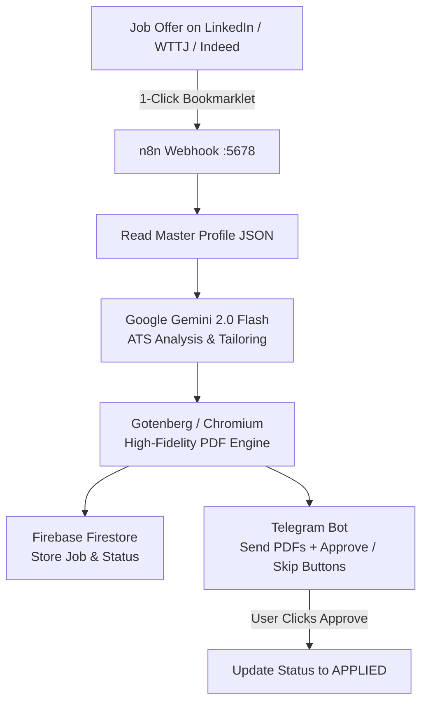

# 🤖 Job Assistant n8n (Local Mac Setup)

An intelligent, ATS-compliant automation pipeline running locally on your Mac. It analyzes job offers, tailors your CV bullet points and French/English cover letter (lettre de motivation) using **Google Gemini**, compiles them into pixel-perfect PDFs, logs everything to **Firebase Firestore**, and sends an instant push notification to your **Telegram** with inline **[Approve & Apply]** buttons.

---

## 🏗️ Architecture Overview



---

## 📁 Project Structure

```
jobAssistant N8n/
├── docker-compose.yml          # Local n8n + Gotenberg PDF engine
├── .env.example                # Configuration template (Gemini, Telegram, Firebase)
├── .gitignore                  # Keeps credentials and PDFs safe
├── credentials/
│   └── serviceAccountKey.json  # Drop your Firebase Admin key here
├── data/
│   └── master_profile.json     # Your master CV data (experiences, skills, contact)
├── templates/
│   ├── cv_template.html        # Clean, modern, ATS-parsable CV template
│   └── cover_letter_template.html # Matching Lettre de Motivation template
├── workflows/
│   ├── job_assistant_main.json # Main n8n workflow (Webhook -> Gemini -> PDF -> Telegram)
│   └── telegram_callback.json  # Telegram button callback workflow
├── tools/
│   ├── bookmarklet.js          # 1-click job scraper code
│   └── bookmarklet_installer.html # Drag-and-drop installer for browser bookmarks bar
└── scripts/
    ├── render_html.js          # HTML template hydrator
    ├── generate_preview.js     # Generates preview CV & Letter locally
    ├── test_gemini.js          # Verifies your Gemini API key
    └── test_firebase.js        # Verifies your Firebase Firestore connection
```

---

## ⚡ 5-Minute Quickstart

### Step 1: Copy `.env.example` to `.env`
```bash
cp .env.example .env
```

### Step 2: Fill your 3 credentials in `.env`

1. **Google Gemini API Key (Free):**
   * Go to [Google AI Studio](https://aistudio.google.com/app/apikey).
   * Create an API key and set `GEMINI_API_KEY=AIzaSy...`

2. **Telegram Bot Token & Chat ID (Free):**
   * Open Telegram and message `@BotFather`. Send `/newbot`, choose a name and username. Copy the token to `TELEGRAM_BOT_TOKEN`.
   * Message `@userinfobot` on Telegram to get your numeric Chat ID. Copy it to `TELEGRAM_CHAT_ID`.
   * Send a first message (e.g. "hi") to your new bot so it has permission to message you.

3. **Firebase Firestore Admin Key (Free):**
   * Go to [Firebase Console](https://console.firebase.google.com/).
   * Create a project (or use an existing one) and enable **Cloud Firestore** (Test mode or production rules).
   * Go to **Project Settings** (gear icon) $\rightarrow$ **Service Accounts** $\rightarrow$ Click **Generate new private key**.
   * Save the downloaded `.json` file as `credentials/serviceAccountKey.json`.
   * Set `FIREBASE_PROJECT_ID=your-project-id` in `.env`.

---

### Step 3: Customize Your Master Profile

Open [`data/master_profile.json`](file:///Users/abdelhakmirbah/Desktop/CVs/jobAssistant%20N8n/data/master_profile.json) and replace the placeholder text with your:
* Contact details (Name, Email, Phone, LinkedIn, GitHub).
* Real work experience and bullet points.
* Real technical skills and education.

You can preview the rendered documents anytime by running:
```bash
npm run generate-preview
```
This generates HTML and PDF previews in the [`output/`](file:///Users/abdelhakmirbah/Desktop/CVs/jobAssistant%20N8n/output/) directory.

---

### Step 4: Start n8n & PDF Engine

Make sure **Docker Desktop** is open on your Mac, then run:
```bash
docker compose up -d
```
Your local services are now running:
* **n8n Web UI:** [http://localhost:5678](http://localhost:5678)
* **Gotenberg PDF Engine:** [http://localhost:3000](http://localhost:3000)

*(Alternative: If you prefer not to use Docker, you can run `npx n8n` directly in your terminal).*

---

### Step 5: Import Workflows into n8n

1. Open [http://localhost:5678](http://localhost:5678) in your browser.
2. Complete the initial 1-minute local account setup.
3. In n8n, click **Workflows** $\rightarrow$ **Add Workflow** $\rightarrow$ Click the **`...`** (top right) $\rightarrow$ **Import from File**.
4. Select [`workflows/job_assistant_main.json`](file:///Users/abdelhakmirbah/Desktop/CVs/jobAssistant%20N8n/workflows/job_assistant_main.json).
5. Add your Telegram credential in n8n (enter your Bot Token).
6. Click **Save** and toggle the workflow to **Active**.
7. *(Optional)* Repeat the import for [`workflows/telegram_callback.json`](file:///Users/abdelhakmirbah/Desktop/CVs/jobAssistant%20N8n/workflows/telegram_callback.json) for inline button actions.

---

### Step 6: Install the 1-Click Browser Bookmarklet

1. Open [`tools/bookmarklet_installer.html`](file:///Users/abdelhakmirbah/Desktop/CVs/jobAssistant%20N8n/tools/bookmarklet_installer.html) in your browser (Chrome, Brave, Safari).
2. Drag the blue **"⚡ Tailor with Job Assistant"** button onto your browser's Bookmarks bar.
3. When viewing any job on LinkedIn, Welcome to the Jungle, or Indeed:
   * Click the bookmark.
   * A popup appears with extracted title, company, and description.
   * Click **"🚀 Tailor & Send to Telegram"**.
   * Within seconds, your phone buzzes with your customized CV & Cover Letter PDFs ready for approval!

---

## 🧪 Testing Your Components

```bash
# 1. Test your Google Gemini API key
npm run test-gemini

# 2. Test your Firebase connection
npm run test-firebase

# 3. Generate a local preview of CV and Cover Letter
npm run generate-preview
```

---

## 🤖 Automated Job Scraping Pipeline (JobSpy + Gemini)

The assistant uses **JobSpy** (`ts-jobspy`), the popular open-source multi-board scraper library, to query targeted roles directly (Indeed, LinkedIn, etc.):

```bash
# Process up to 3 matching jobs (minimum 60% fit score)
./run_job_assistant.sh

# Or pass custom limits: ./run_job_assistant.sh <max_jobs> <min_score>
./run_job_assistant.sh 5 65
```

### Search Configuration in `.env`:
```ini
JOB_SEARCH_TERMS=Junior Software Engineer,Software Engineer,Junior Data Engineer,Data Engineer,Développeur Full Stack,Développeur Mobile
JOB_LOCATION=Morocco
JOB_COUNTRY=morocco
```
